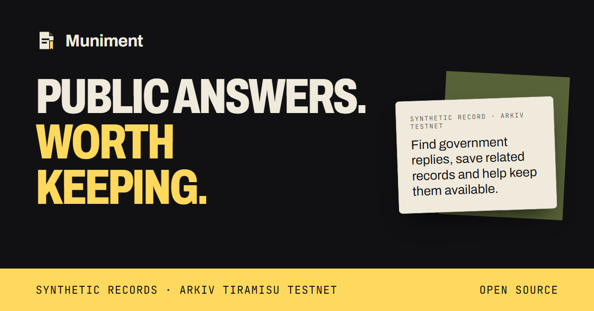
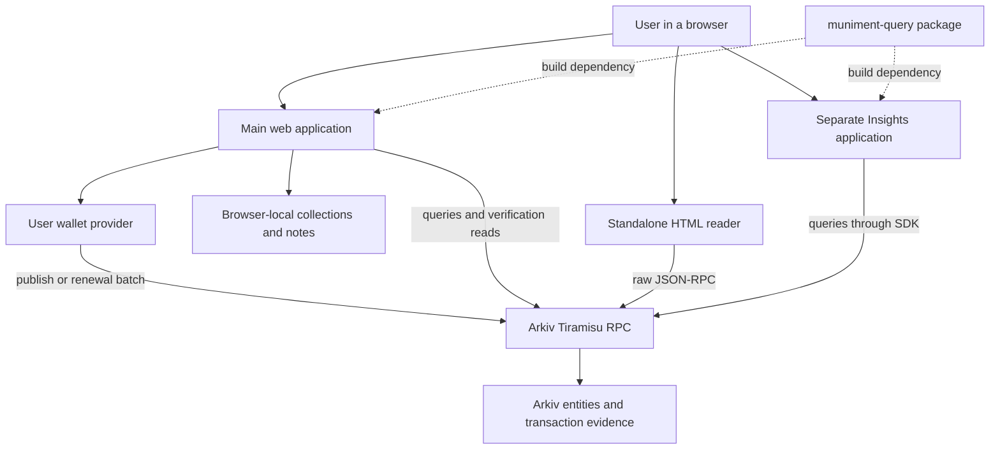
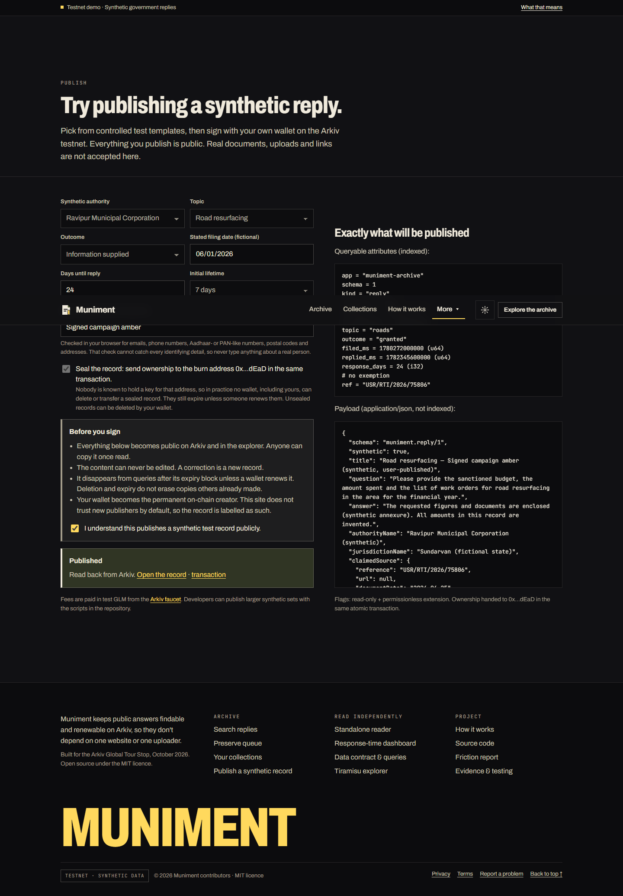
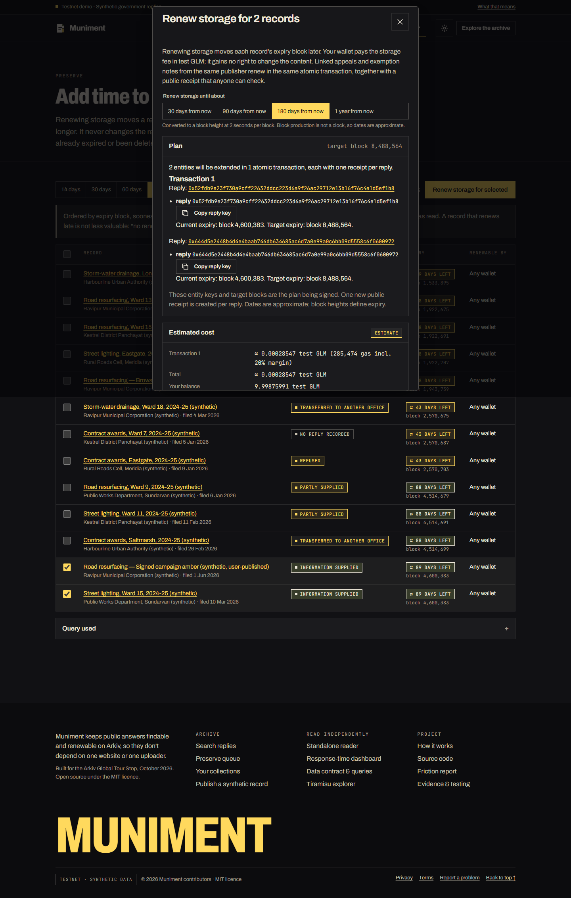
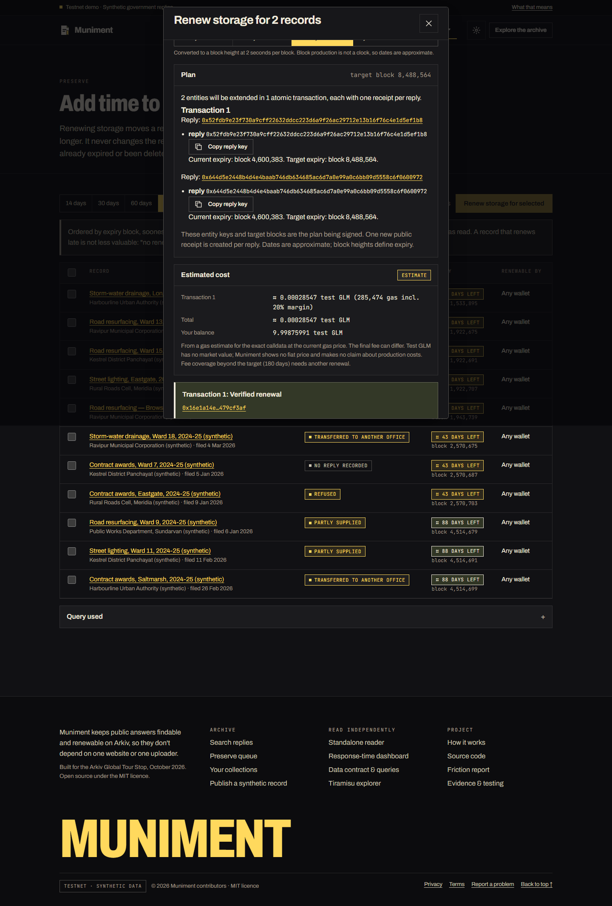
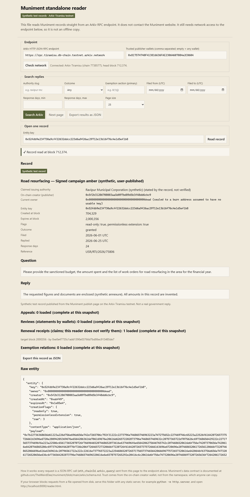

<p align="center">
  
</p>

# Muniment

**Public answers. Worth keeping.**

Find, cite and renew public records without depending on one website or one uploader. Muniment stores queryable records on Arkiv, lets other wallets extend their storage, and gives readers a separate way to retrieve the same data.

[Explore the archive](https://muniment-archive.vercel.app/) · [Insights](https://muniment-insights.vercel.app/) · [Standalone reader](https://muniment-archive.vercel.app/reader.html) · [Watch the demo](https://github.com/TheWeirdDee/muniment/releases/download/demo-2026-10-16/muniment-demo.mp4)


> **Testnet demonstration.** Documents, authorities and figures are fictional. Storage operations and recorded transactions are real Tiramisu testnet actions, chain ID **7738577**, using test GLM. This is neither a mainnet deployment nor a claim that any government issued these documents.

Built for the **Arkiv Global Tour Stop, 9–18 October 2026**. Tracks: **Censorship Resistance** and **Open Source**.

## Contents

- [The problem](#the-problem)
- [Why Arkiv](#why-arkiv)
- [Features](#features)
- [How it works](#how-it-works)
- [Architecture](#architecture)
- [Data contract](#data-contract)
- [Publishing and sealing](#publishing-and-sealing)
- [Permissionless renewal](#permissionless-renewal)
- [Independent verification](#independent-verification)
- [See the application](#see-the-application)
- [Transaction evidence](#transaction-evidence)
- [Quick start](#quick-start)
- [Configuration](#configuration)
- [Checks and builds](#checks-and-builds)
- [Reproduce the core claim](#reproduce-the-core-claim)
- [Repository layout](#repository-layout)
- [Security and limitations](#security-and-limitations)
- [Hackathon submission](#hackathon-submission)
- [Documentation](#documentation)
- [Contributing](#contributing)
- [Licence and acknowledgments](#licence-and-acknowledgments)

## The problem

In August 2023, The Wire and National Herald, citing The Hindu, reported that records of past applications had disappeared from India's RTIOnline portal. The portal showed a maintenance notice saying archival data would be available soon, and the department running it did not respond to The Hindu's questions. [The Wire](https://m.thewire.in/article/government/rti-portal-rtionline-years-of-information-disappears), [National Herald](https://www.nationalheraldindia.com/amp/story/national/rti-years-of-data-go-missing-from-the-union-governments-information-portal).

This reporting describes loss of access at that time, not proof of permanent deletion. Muniment is an independent preservation demonstration; it has not recovered or imported those applications and does not replace the official RTI portal.

A reply to an information request can disappear when a portal changes, a publisher removes a page or a researcher loses their only copy. A saved document also needs context: who uploaded it, what it claims to be, and whether someone has disputed or corrected it.

Muniment makes the record searchable and renewable independently of its original publisher. It separates the claimed issuing authority from the wallet that actually published the entity. Keeping a record available preserves evidence of what was submitted; it does not establish that the document is true.

The intended users are journalists, civic researchers and people assembling citation bundles. This edition demonstrates the mechanism with synthetic records rather than publishing real personal information.

RTI applicants can use the same approach to keep and cite replies separately from the original portal. Find a record through public attributes, inspect its publisher and provenance, save related replies in a local collection, and fund storage renewal when needed. A standalone reader retrieves the same entities without a Muniment server. These reads still need an accessible Arkiv endpoint; storage is renewable, not automatically permanent.

### Public RPC availability

The public Tiramisu endpoint can throttle requests. An advertised cooldown is retained across clients and, when browser storage is available, reloads and same-origin tabs. Calls respect that cooldown instead of repeatedly probing the endpoint. Identical reads already share in-flight requests and the main browser client caches successful reads briefly. The homepage requests one preview record, defers renewal candidates until requested, and refreshes its block estimate less frequently. When live data is unavailable it shows a product explanation and navigation, with the real RPC error available in a disclosure; it never substitutes invented live records.

Avoid repeated refreshes during a cooldown. Settings accepts another authorized Tiramisu endpoint, but no independent second provider has been verified. A 429 response alone does not establish whether the limit is per browser, account, public IP or shared network, and these changes cannot increase the upstream quota or guarantee immediate access.

## Why Arkiv

The central operation is specific: **another wallet can keep a record available without gaining permission to change it**.

| Requirement | Arkiv mechanism | What the user gets |
|---|---|---|
| Search records without a Muniment backend | Typed queryable attributes and public RPC | Independent filtering and retrieval |
| Preserve submitted content | Read-only creation flag | Existing content cannot be patched |
| Reduce dependence on the original owner | Atomic ownership transfer to a conventional burn address | Sealed records cannot be deleted while the keyless-address assumption holds |
| Let others fund continued availability | Permissionless lifetime extension | Renewal without publisher cooperation |
| Check what a renewal did | Atomic batches, receipt entities and transaction events | Reviewed keys and exact expiry targets can be reconciled |
| Build another interface | Public data contract and reusable query package | Reader and Insights work without a private Muniment API |

A conventional operator-controlled database leaves publication policy with its operator. IPFS can distribute bytes, but a CID alone does not supply these query and renewal semantics. Other architectures could reproduce parts of the system with additional contracts, indexing and operational responsibilities; Arkiv supplies the combined properties used here.

**Kept off Arkiv:** keys, credentials, personal data, browser collections and notes, saved searches, full-text indexes and synthetic source fixtures.

## Features

- **Archive:** authority, jurisdiction, topic, outcome, exemption, filing-date and completed-response-time filters; cursor pagination. Text search and alternate sorting explicitly cover loaded records only.
- **Provenance:** immutable on-chain creator displayed separately from claimed issuer, source status, wallet reviews, disputes and same-creator corrections.
- **Preservation:** expiry queue and itemized renewal plans covering eligible replies, appeals and exemption relations from the same creator.
- **Collections:** local bookmarks and private notes, JSON import/export and collection renewal. Notes are excluded from exports unless selected.
- **Synthetic publishing:** controlled templates, input checks, preview and optional atomic sealing.
- **Independent reading:** one self-contained HTML file using raw JSON-RPC; no wallet, SDK, CDN or Muniment API required.
- **Insights:** a separately deployed application calculating live counts, medians, outcomes and waiting times from the same public contract.
- **Live refresh:** WebSocket entity events and labelled periodic reconciliation on record pages.

## How it works

1. **Find** a reply through typed Arkiv queries.
2. **Inspect** its creator, claimed issuer, source, reviews, ownership and expiry.
3. **Save** it to a browser collection and export a citation bundle if useful.
4. **Renew** eligible entities after reviewing the keys, target block, transaction grouping and estimated test GLM fee.
5. **Verify** the transaction, receipt claims and resulting entity expiries; use the reader or another application to retrieve the records independently.

Browsing and local bookmarking require no wallet. Publication and renewal are blockchain writes requiring a connected, funded Tiramisu wallet.

## Architecture



The main app and Insights are static clients. There is no Muniment backend database, private query API or proprietary indexer in these paths. The HTML reader contains its own raw-RPC implementation; it does not import the query package at runtime. The wallet uses its configured Tiramisu connection for writes. Browser-local notes are not sent to Arkiv.

**Text fallback:** Main app → wallet for approved writes; main app, reader and dashboard → Arkiv for reads. Arkiv stores the records and transaction evidence. The query package is reused by the main app and dashboard. Collections stay in the main app's browser profile.

See [architecture](docs/architecture.md) for modules and trust boundaries.

## Data contract

Namespace: `muniment-archive`; schema version: `1`.

| Entity | Purpose | Important links |
|---|---|---|
| Reply | Synthetic question, reply, authority and provenance | Optional `corrects` key |
| Appeal | Related appeal claim | `reply` key |
| Exemption | Searchable relation for a cited section | `reply` key and `section` |
| Receipt | Claim about a renewal target and entity count | `reply`, `target_expiry` |
| Review | A wallet's statement about a record | `reply` key |

Queryable values use typed attributes: `str`, `u64`, `i32`, `key`, and the synthetic boolean. JSON payloads carry longer text and structured source information. Arkiv's `$creator` and `$owner` are chain metadata, not freely writable claims of authority.

Examples include compound outcome/date predicates, `$expiresAt` ranges for preservation, creator allowlists and cursor pagination pinned to the first response's block. Secondary exemption searches use relation entities. See [schema and curl reproduction](arkiv/schema.md#reproduce-with-curl), [query implementation](packages/muniment-query/src/queries.ts) and [query package documentation](packages/muniment-query/README.md).

## Publishing and sealing

Publication creates a read-only reply and any exemption relations. When sealing is selected, ownership of those entities transfers to `0x000000000000000000000000000000000000dEaD` in the same atomic batch.

Read-only prevents editing, but it does **not** by itself prevent an owner from deleting or transferring an entity. Sealing relies on the assumption that nobody has a usable private key for the burn address. Most seeded replies are sealed; two are deliberately publisher-held to demonstrate the difference. Each detail page states its actual status.

The browser publish form accepts synthetic templates, not real document uploads. The title-note scanner catches some identifier patterns and cannot guarantee that arbitrary text contains no personal information.

## Permissionless renewal

A renewal sets an **absolute expiry block**. It does not change the record or make the payer its owner.

The planner reads current state, excludes expired, inaccessible or already-covered entities, and groups eligible linked entities from the reply's creator with the reply. One atomic transaction can contain multiple reply units; each unit gets a receipt claim. Work larger than one transaction is explicitly split, so partial completion is possible.

After confirmation, every planned reply must have its expected receipt. The transaction's extension events must match the complete reviewed entity set and target. Every included entity is read back. Delayed verification remains pending; a mismatch stays unverified.

A pre-sign reread and five-minute quote-age guard reduce stale-plan risk. They cannot eliminate races while a transaction is pending. Historical concurrent tests showed equal-target renewals can both succeed; successful payment is not a promise of additional marginal storage beyond that target.

Implementation: [planning](packages/muniment-query/src/renewal.ts), [quote and reads](apps/web/src/lib/renew.ts), [batch reconciliation](apps/web/src/lib/renew-reconcile.ts).

## Independent verification

A receipt entity is a **claim**, not proof on its own. Verification locates its creation transaction and checks that the successful transaction was sent by the receipt creator and extended the named reply to the claimed target. The signing dialog additionally reconciles every reviewed batch entity and receipt.

The standalone reader displays renewal receipts as claims and explicitly does not certify them. It exposes record and linked-entity data for independent inspection. Insights computes aggregates; it is not a document-authenticity service.

All clients still depend on access to a compatible Arkiv endpoint and the testnet remaining available. Hosting a reader elsewhere removes dependence on the Muniment origin; it does not provide offline blockchain access or guaranteed permanence.

## See the application

The following are actual historical campaign screenshots, not fabricated interfaces or fresh claims about every current wallet.

| Publication | Renewal review |
|---|---|
|  |  |

| Retained renewal results | Independent reader |
|---|---|
|  |  |

[Watch the 1:44 demo](https://github.com/TheWeirdDee/muniment/releases/download/demo-2026-10-16/muniment-demo.mp4) · [Captions](demo/muniment-demo.srt)

## Transaction evidence

The 17 October campaign records four deployed-UI transactions through an isolated EIP-1193 test wallet. This is not third-party extension or hardware-wallet certification.

| Action | Tiramisu transaction | Block |
|---|---|---:|
| Synthetic publication | [0xdd15a633…aff8418](https://tiramisu.explorer.arkiv.network/tx/0xdd15a633aa62d588392cb1e5e9585ae13ab8a0679a9d3523d0d02b506aff8418) | 704329 |
| Single-reply renewal | [0xfe501a8a…ec6c2ace](https://tiramisu.explorer.arkiv.network/tx/0xfe501a8a39ee5ee12467e40ddf4836882a43f44df779ad3b86e9adacec6c2ace) | 704405 |
| Initial two-reply renewal | [0x71af298a…8fb3840f](https://tiramisu.explorer.arkiv.network/tx/0x71af298abe614e5b338ba5c7d479ce66025d650716155f96e148fbed8fb3840f) | 712391 |
| Retained-results repeat | [0x16e1a14e…479cf3af](https://tiramisu.explorer.arkiv.network/tx/0x16e1a14ea04d2cadc0ece0a46bdaeac8c97509e9f8824c892b5fd327479cf3af) | 712569 |

[Full hashes, wallets, five receipt claims and five extension results](docs/transaction-campaign-2026-10-17.md) · [Machine-readable campaign](evidence/transactions-2026-10-17/campaign.json)

Evidence categories remain separate:

- **On-chain:** successful transactions, recorded operations and entity readbacks.
- **Separate implementation, same provider:** campaign reconciliation used the public Tiramisu provider independently of the application verifier; it was not a second-provider test.
- **Simulated boundaries:** rejection passed with zero broadcasts; later network readiness was quota-blocked and the serial stale-quote case was skipped.
- **Not established:** universal wallet compatibility, second independent RPC provider, mainnet readiness or real user demand.

Later renewals can increase current expiry beyond an earlier transaction's target. Compare historical transaction events with their own reviewed target, rather than treating today's expiry as the original outcome.

## Quick start

Prerequisites: **Node 20.19+ and npm 11**. Read-only development needs no wallet keys or `.env` file.

```bash
git clone https://github.com/TheWeirdDee/muniment.git
cd muniment
npm ci
npm run build:query
npm run dev -w muniment-web
```

The main app runs at `http://localhost:5173` and reads the public Tiramisu archive.

In another terminal:

```bash
npm run dev -w muniment-insights
```

Insights uses port `5174` and its own browser configuration.

For the self-contained reader, save [reader/reader.html](reader/reader.html) and open it in a browser that permits file-origin RPC requests. Alternatively:

```bash
python3 -m http.server 8000 --directory reader
```

Then open `http://localhost:8000/reader.html`. Network access to an Arkiv endpoint is still required. This static serving command is standard usage; it is not a claim that every browser's file-origin policy was tested.

## Configuration

| Variable or setting | Scope | Purpose |
|---|---|---|
| `VITE_TRUSTED_PUBLISHERS` | Public web build | Comma-separated publisher allowlist |
| `VITE_TRUSTED_REVIEWERS` | Public web build | Trusted review wallets |
| `VITE_SITE_URL` | Public web build | Main site canonical URL |
| `VITE_DASHBOARD_URL` | Public web build | Separate dashboard link |
| Main app Settings | Browser-local | HTTP/WebSocket endpoint and any-wallet view |
| Insights controls | Dashboard browser-local | Publisher list and HTTPS endpoint |
| Reader controls | Reader browser-local | RPC endpoint and publisher list |
| `ARKIV_RPC_URL` | Operator scripts | Optional server-side endpoint override |
| `PUBLISHER_KEY` / `PUBLISHER_ADDRESS` | Operator-only | Synthetic seeding wallet |
| `RENEWER_KEY` / `RENEWER_ADDRESS` | Operator-only | Permissionless-renewal proof wallet |
| `REVIEWER_KEY` / `REVIEWER_ADDRESS` | Operator-only | Review proof wallet |
| `STRANGER_KEY` / `STRANGER_ADDRESS` | Operator-only | Control/permission proof wallet |

`VITE_*` values ship to visitors and must never contain secrets. Use only disposable testnet keys for authorized operator workflows; never commit `.env` or put keys in browser code, URLs or reports. Reading requires none of these keys.

[.env.example](.env.example) describes operator placeholders. `seed`, `proof`, `measure`, resilience and campaign scripts have their own scopes; inspect them before use. **Do not run write-capable scripts merely to browse or audit the archive.**

## Checks and builds

These package/component/type/build commands were freshly executed at source revision `594bd6bc3b119a1324155ace3e8cf5497e40b614` during a read-only audit, in a disposable build copy:

```bash
npm run build:query
npm test
node node_modules/vitest/vitest.mjs run tests/components
npm run typecheck
npm run build -w muniment-web
npm run build -w muniment-insights
```

Historical audit result: **51 package tests and 18 component/reconciliation tests passed** at that revision. The current package/component inventory is **67 tests in nine files and 23 tests in four files**, including RPC cooldown regressions. See the [remediation record](docs/audit-remediation-2026-10-18.md) for dated validation and retained initial failures.

The new offline matrix passed **55 checks across five widths**; this is controlled browser coverage, not third-party wallet certification. The repository also contains Playwright suites for routes, accessibility and live flows. See [testing](docs/testing.md) before running them: several optional cases can sign transactions or use operator keys. Historical reports must not be presented as fresh browser results. The audited revision had no GitHub Actions workflow; [read-only CI](.github/workflows/checks.yml) now runs tests, builds and the [offline browser regression suite](playwright.audit.config.ts). Run it with `npx playwright test --config playwright.audit.config.ts`; it uses synthetic providers and intercepted RPC, without private keys or public writes.

## Reproduce the core claim

1. Open the archive with its default trusted publisher list. Try the refused-outcome filter; seven seeded refused replies were visible at the audited checkpoint.
2. Open a record. Compare claimed issuer, immutable creator, sealed/publisher-held ownership and actual expiry block.
3. Run the exact read-only query in [schema.md](arkiv/schema.md#reproduce-with-curl). Preserve `blockNumber`, query, projection and page size when continuing with a cursor.
4. Open the standalone reader and look up the same key. It reads directly from Arkiv rather than a Muniment API.
5. Inspect the existing publication and renewal transactions above. Match each receipt's reply/target with the creating transaction and extension operations. Do not sign a new transaction to verify an old one.
6. Open Insights and compare headline counts with the records returned by the public query. At the audit checkpoint: 41 replies, 35 completed with recorded times, median 30 days, seven refused and six unanswered.
7. If deliberately testing a new renewal, use a funded Tiramisu test wallet, review the complete plan first and retain the transaction hash. This is a separate write operation, not required for read-only reproduction.

When the public endpoint throttles, preserve the actual error and retry time. Wait as instructed or configure an endpoint you are authorized to use. Do not treat quota failures as empty data and do not repeatedly run proof/seed scripts to recover a pending transaction.

## Repository layout

```text
muniment/
├── apps/
│   ├── web/                    React archive, publishing and preservation
│   └── dashboard/              Separate TypeScript Insights application
├── packages/
│   └── muniment-query/         Schema, queries, decoding, planning and verification
├── reader/
│   └── reader.html             Self-contained raw-RPC reader
├── arkiv/                      Schema, friction report and reproduction probes
├── corpus/
│   └── sources/                Fictional source fixtures
├── demo/                       Captions and demo notes
├── docs/                       Architecture, trust, testing and submission guides
├── evidence/                   Historical results, screenshots and manifests
├── scripts/                    Seed, proof, measurement and release utilities
├── tests/
│   ├── components/             Web reconciliation/component regressions
│   └── e2e/                    Browser suites, including optional write cases
├── MUNIMENT_PRD.md
├── SPONSOR_BEHAVIOUR.md
├── THIRD_PARTY_NOTICES.md
└── README.md
```

## Security and limitations

- **Availability is renewable, not permanent.** Expired/deleted records leave live queries; other parties can retain previously read copies.
- **Sealing is conditional.** It depends on the burn-address assumption and does not prevent expiry or a testnet reset.
- **Creator is not authority.** A wallet proves publication by that wallet, not government issuance, a person's identity or truth.
- **Receipts require verification.** Wallet counts are not counts of people; expired receipts disappear from live counts.
- **Collections have no server backup.** Anyone with access to the browser profile can read local notes. Export deliberately and review note inclusion.
- **Public RPC is a dependency.** Queries are bounded and may be incomplete or throttled; one independent provider has not been established.
- **Independent tools have narrower scopes.** The reader displays claims without running the main verifier; alternate sorting and text search are limited to loaded records.
- **Wallet coverage remains scoped.** Provider cleanup, collection-plan retention and hash-known recovery have controlled regression tests. Submitted hashes are retained in tab storage and rechecked without a signature. Real third-party extension/hardware-wallet compatibility and every provider failure mode remain untested; disabling tab storage limits reload recovery.
- No independent usability session, long-running reliability guarantee or mainnet-readiness claim is made.

Read [threat model](docs/threat-model.md), [testing limits](docs/testing.md) and [renewal remediation history](docs/renewal-remediation.md). For suspected vulnerabilities, follow [SECURITY.md](SECURITY.md); do not post secrets or exploit details in public issues.

## Hackathon submission

Primary track: **Censorship Resistance**. Secondary track: **Open Source**. The submission draft does not enter Best Indian Use Case.

The official deadline is **18 October 2026, 22:59 UTC / 23:59 Africa/Lagos**. Judges assess the recorded deadline revision; keep deployments available through 23 October. See the [canonical rules](https://github.com/Arkiv-Network/global-tour-stop-pre-devcon), [submission draft](docs/submission.md) and [requirements evidence](docs/requirements-checklist.md).

Public code and signed transactions do not establish that Devfolio submission is complete. Team eligibility, roster, required answers, track choices, links, AI-use declaration and actual submission confirmation require owner verification.

## Documentation

| Need | Read |
|---|---|
| Product scope | [PRD](MUNIMENT_PRD.md) |
| System and modules | [Architecture](docs/architecture.md) |
| Data types and exact queries | [Schema](arkiv/schema.md) |
| SDK/node feedback | [Friction report](arkiv/friction.md) |
| Trust and privacy | [Threat model](docs/threat-model.md) |
| Tests and historical outcomes | [Testing](docs/testing.md) |
| Four-transaction campaign | [Signed campaign](docs/transaction-campaign-2026-10-17.md) |
| Verification changes | [Renewal remediation](docs/renewal-remediation.md) |
| Deployment and rollback | [Deployment](docs/deployment.md) |
| Requirements and limits | [Checklist](docs/requirements-checklist.md) |
| Submission declarations | [Submission evidence](docs/submission-evidence.md) |
| Query package reuse | [Package README](packages/muniment-query/README.md) |
| Measurements | [Sponsor behaviour](SPONSOR_BEHAVIOUR.md) |

## Contributing

See [CONTRIBUTING.md](CONTRIBUTING.md) for setup, regression checks and reporting guidance.

Read the data contract and threat model first. Reproduce a defect with its route/key, source revision and exact error; distinguish RPC failure, missing data and malformed data. Include a minimal regression case and run the checks above for affected code. Use synthetic fixtures and keep signed tests explicitly opt-in.

Changes to schema/query semantics must remain consistent across the package, main app, reader, Insights and documentation. New evidence should preserve prior failures and describe which revision and environment it actually tests. Discuss interface or protocol changes with maintainers before broad refactors.

## Licence and acknowledgments

[MIT](LICENSE). The synthetic corpus and original brand assets are covered by the project licence. Dependencies and fonts retain their own licences; see [third-party notices](THIRD_PARTY_NOTICES.md).

Built with Arkiv SDK 0.8.1, viem, React, React Router, Vite, Archivo and JetBrains Mono. AI coding-assistant use and its evidence limits are disclosed in the [submission draft](docs/submission.md) and [submission evidence](docs/submission-evidence.md).
